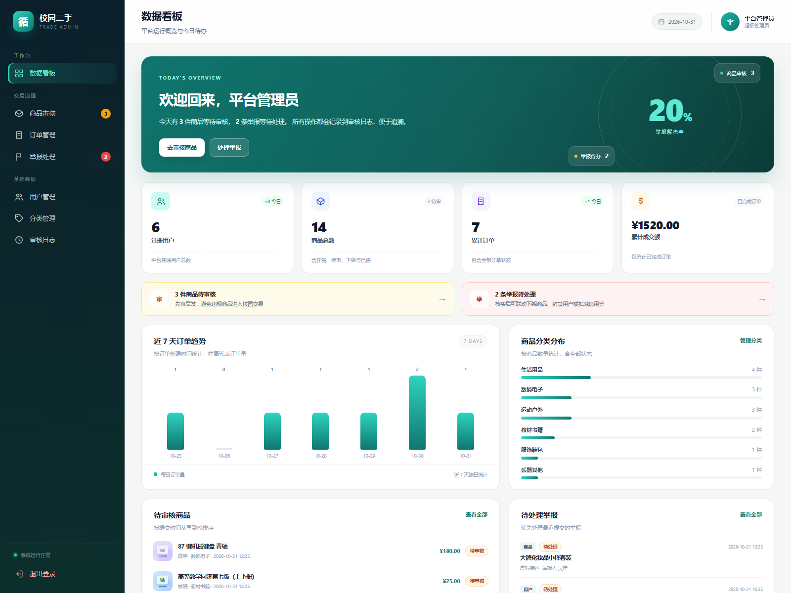
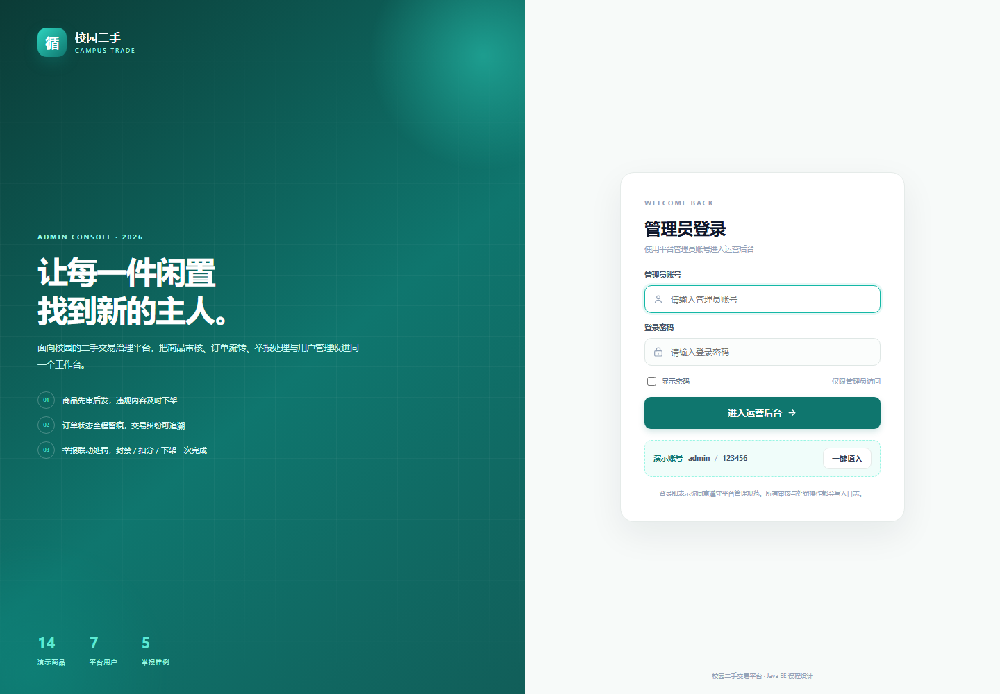
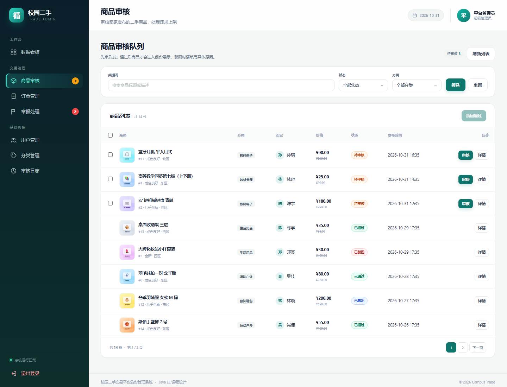
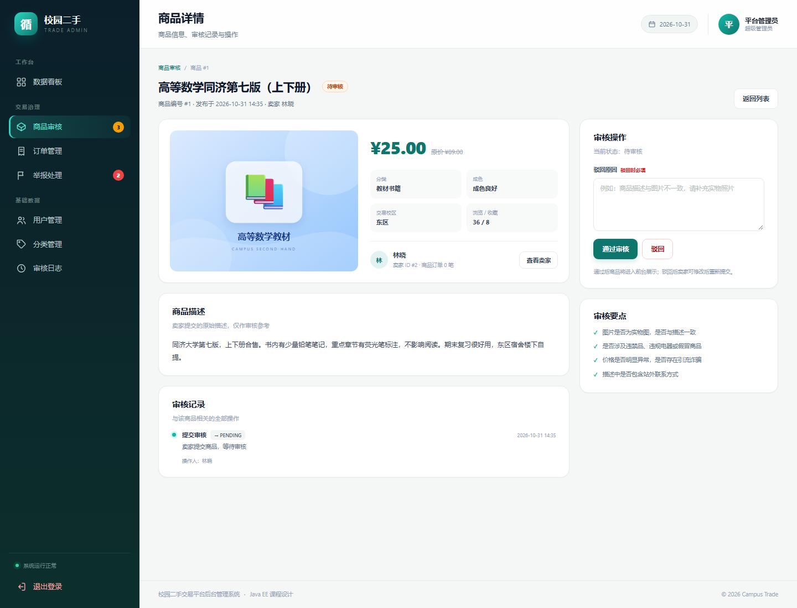
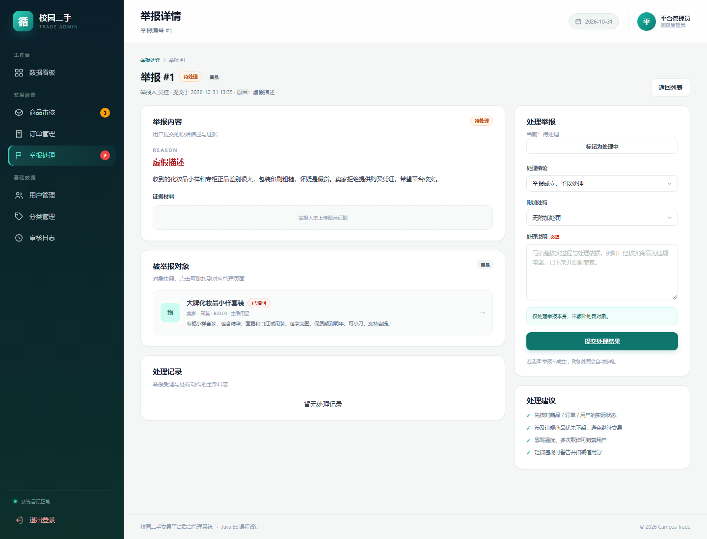
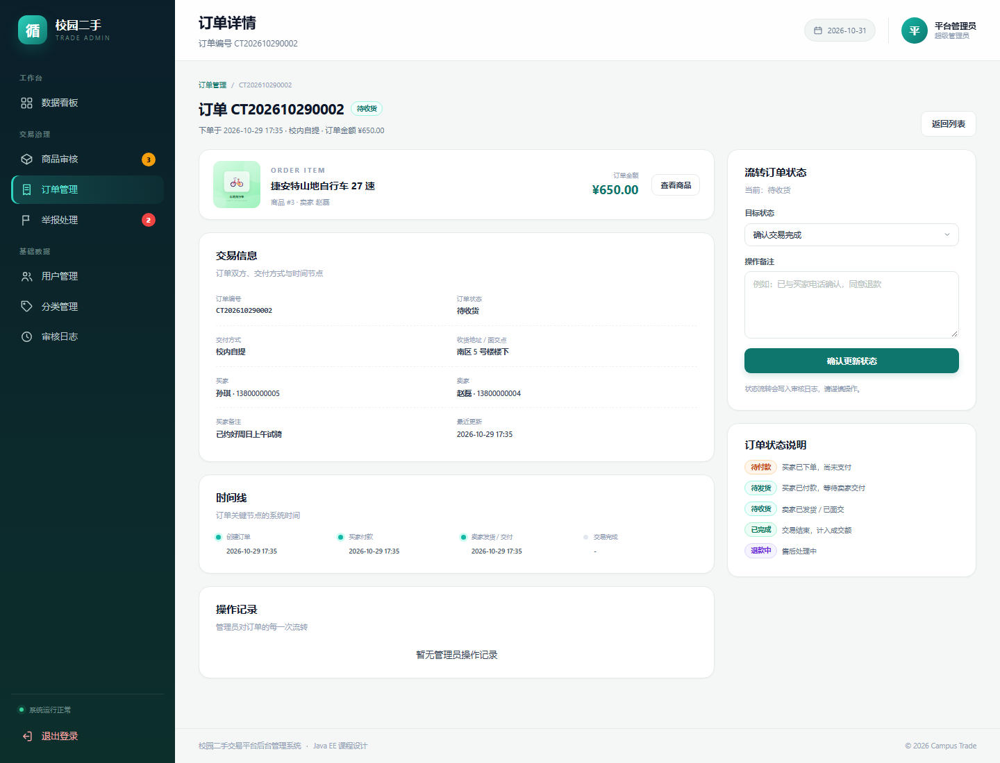

# 校园二手交易平台后台管理系统

> Java EE 课程设计 · 商品审核 / 订单管理 / 举报处理 / 用户与分类管理 / 审核日志
>
> ✅ 已在本机 **JDK 25 + Tomcat 11.0.22 + MySQL 8.0.46** 上完成构建、部署、登录、全部页面与核心操作验证。  
> 当前运行地址：<http://localhost:8080/campus-trade-admin/>（若已停止，运行 `scripts\start-server.bat` 即可）。



## 一、项目简介

这是一个面向校园二手交易的**后台管理系统**。学生发布二手商品后，管理员在后台完成「先审后发」；交易产生订单后，管理员可以查看订单全流程并进行状态流转；用户提交举报后，管理员可核实并联动执行「商品下架 / 封禁用户 / 警告扣分」，所有关键操作都会写入审核日志。

项目采用经典的 **Servlet + JSP + JDBC + MySQL** 分层架构，不依赖 Spring Boot，适合 Java EE / Java Web 课程设计，也方便在答辩时讲清楚 MVC、Filter、Session、事务、连接池等基础知识点。

## 二、已实现功能

| 模块 | 功能 |
| --- | --- |
| 登录认证 | 管理员账号登录、Session 会话、登录拦截、退出登录、PBKDF2 密码校验 |
| 数据看板 | 用户/商品/订单/成交额统计、近 7 天订单趋势、分类占比、待办商品与举报、最近操作 |
| 商品审核 | 关键词/状态/分类筛选、分页、详情、通过、驳回（必填原因）、批量通过、下架、重新上架、删除 |
| 订单管理 | 订单号/商品/买家/卖家搜索、状态筛选、详情、状态机流转、操作备注、Excel 导出 |
| 举报处理 | 举报列表、详情、对象快照、受理、处理结论、联动下架商品/封禁用户/扣 5 分信用、Excel 导出 |
| 用户管理 | 用户列表、详情、发布商品/订单/举报记录、封禁、解封、重置密码 |
| 分类管理 | 分类列表、新增、编辑、排序、启用/停用、删除保护（分类下有商品时禁止删除） |
| 审核日志 | 按业务类型/动作/关键词筛选，记录商品、订单、举报、用户、分类的全部关键操作 |
| 通用能力 | 分页、统一异常提示、Flash 消息、事务、PreparedStatement 防注入、响应式管理端 UI |

## 三、技术栈

| 层次 | 技术 | 版本 |
| --- | --- | --- |
| JDK | Oracle JDK | 25.0.4.1（项目编译目标 Java 21） |
| Web 容器 | Apache Tomcat | 11.0.22 |
| Web 规范 | Jakarta Servlet / JSP / JSTL | 6.1 / 3.1 / 3.0 |
| 数据库 | MySQL Community Server | 8.0.46 |
| 连接池 | Druid | 1.2.16 |
| JDBC 工具 | Apache Commons DbUtils | 1.7 |
| Excel | Apache POI | 5.2.5 |
| 构建 | Apache Maven | 3.9.16 |
| IDE | IntelliJ IDEA Ultimate | 2025.3.3 |
| 前端 | 原生 HTML / CSS / JavaScript | 无 Node、无 CDN 依赖 |

## 四、快速启动（本机已验证）

> 项目路径：`D:\学校\java  ee\期末大作业\campus-trade-admin`

### 第 1 步：确认 MySQL 已启动

本机 MySQL 80 服务默认已启动，端口 `3306`，账号 `root / 123456`。

如果数据库不存在，项目首次启动会自动建库、建表并写入演示数据；也可以手动执行：

```bat
scripts\init-db.bat
```

### 第 2 步：构建 WAR

```bat
cd /d "D:\学校\java  ee\期末大作业\campus-trade-admin"
scripts\build.bat
```

生成文件：`target\campus-trade-admin.war`

### 第 3 步：启动 Tomcat

```bat
scripts\start-server.bat
```

启动成功后访问：

**http://localhost:8080/campus-trade-admin/**

| 账号 | 密码 | 角色 |
| --- | --- | --- |
| `admin` | `123456` | 平台管理员 |
| `linxia` | `123456` | 普通用户（不能登录后台） |

停止服务：

```bat
scripts\stop-server.bat
```

## 五、界面预览

### 登录页



### 商品审核



### 商品详情与审核操作



### 举报处理



### 订单详情与状态流转



## 六、项目结构

```text
campus-trade-admin/
├── pom.xml                          Maven WAR 配置
├── README.md
├── sql/
│   ├── schema.sql                   建库建表脚本
│   └── data.sql                     演示数据（可重复执行）
├── scripts/
│   ├── init-db.bat                  初始化数据库
│   ├── build.bat                    构建 WAR
│   ├── init-tomcat.ps1              创建隔离的本地 Tomcat 实例
│   ├── start-server.bat             启动
│   ├── stop-server.bat              停止
│   ├── run-demo.bat                 构建 + 启动
│   └── tomcat-server.xml            干净的 server.xml 模板
├── src/main/java/com/campus/trade/
│   ├── common/                      数据库、分页、密码、日期、Excel 工具
│   ├── entity/                      User / Product / Order / Report / ...
│   ├── dao/                         JDBC 数据访问
│   ├── service/                     业务逻辑与事务
│   ├── servlet/                     控制器
│   ├── filter/                      编码、登录、侧边栏待办
│   ├── listener/                    启动时自动初始化数据库
│   └── web/                         BaseServlet
├── src/main/resources/
│   ├── db.properties                数据库连接配置
│   ├── log4j2.xml                   POI 日志配置
│   └── sql/                         自动初始化用 SQL
├── src/main/webapp/
│   ├── WEB-INF/web.xml
│   ├── WEB-INF/views/               JSP 页面（禁止直接访问）
│   └── assets/                      CSS / JS / 商品 SVG 图
└── docs/                            环境报告、设计文档、辅导手册、部署手册、答辩提纲
```

## 七、文档索引

| 文档 | 内容 |
| --- | --- |
| [环境检查报告](docs/01-环境检查报告.md) | 本机软件清单、版本能力、环境适配结论 |
| [系统设计说明书](docs/02-系统设计说明书.md) | 架构、ER 图、表结构、状态机、路由、安全设计 |
| [开发辅导手册](docs/03-开发辅导手册.md) | 从 IDEA 打开项目到逐模块实现、调试、扩展功能 |
| [部署运行手册](docs/04-部署运行手册.md) | 一键脚本、手动部署、IDEA 配置、故障排查 |
| [答辩演示提纲](docs/05-答辩演示提纲.md) | 演示脚本、亮点提炼、常见答辩问题 |
| [已安装软件清单](docs/已安装软件清单.csv) | 本机 147 条软件安装记录（注册表扫描） |

## 八、常见问题

### 1. 访问 404

确认访问地址包含上下文路径：

```text
http://localhost:8080/campus-trade-admin/
```

不要直接访问 `http://localhost:8080/`。

### 2. 启动时报 `JRE_HOME environment variable is not defined correctly`

本机用户环境变量里的 `JRE_HOME` 指向了无效路径。直接使用 `scripts\start-server.bat` 即可，它会把 `JRE_HOME` 设置为 JDK 25。不要直接双击 Tomcat 安装目录里的 `catalina.bat`。

### 3. 启动时报 `Struts2Demo` 相关错误

本机全局 Tomcat 的 `conf/server.xml` 里残留了一个 `Struts2Demo` 的 Context，且缺少 log4j 依赖，会导致 Tomcat 启动失败。项目脚本会创建一个**独立的 `.tomcat` 实例**并使用干净的 `server.xml`，不会修改你原来的 Tomcat。请使用 `scripts\start-server.bat`，不要直接把 WAR 放进 `D:\apache-tomcat-11.0.22\webapps` 后用原配置启动。

### 4. 页面没有样式 / CSS 被当成 HTML

项目已修复静态资源 MIME 类型问题。如果仍然出现，强制刷新浏览器（`Ctrl + F5`），并确认 `assets/css/admin.css` 返回 `Content-Type: text/css`。

### 5. 数据库密码不是 123456

修改 `src/main/resources/db.properties` 中的 `jdbc.password`，重新构建；或者设置环境变量：

```bat
set CAMPUS_DB_PASSWORD=你的密码
```

### 6. 端口 8080 被占用

修改 `scripts/tomcat-server.xml` 中的 `port="8080"`，并同步修改 `start-server.bat` 里的访问提示。或者先停止占用 8080 的程序。

## 九、说明

- 本项目为课程设计演示系统，支付、短信、实名认证、图片上传等生产功能未接入。
- 演示数据中的商品图片为本地 SVG 插画，不依赖外网。
- 所有密码均为演示密码，真实部署请立即修改 `admin` 密码和数据库密码。
