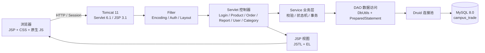
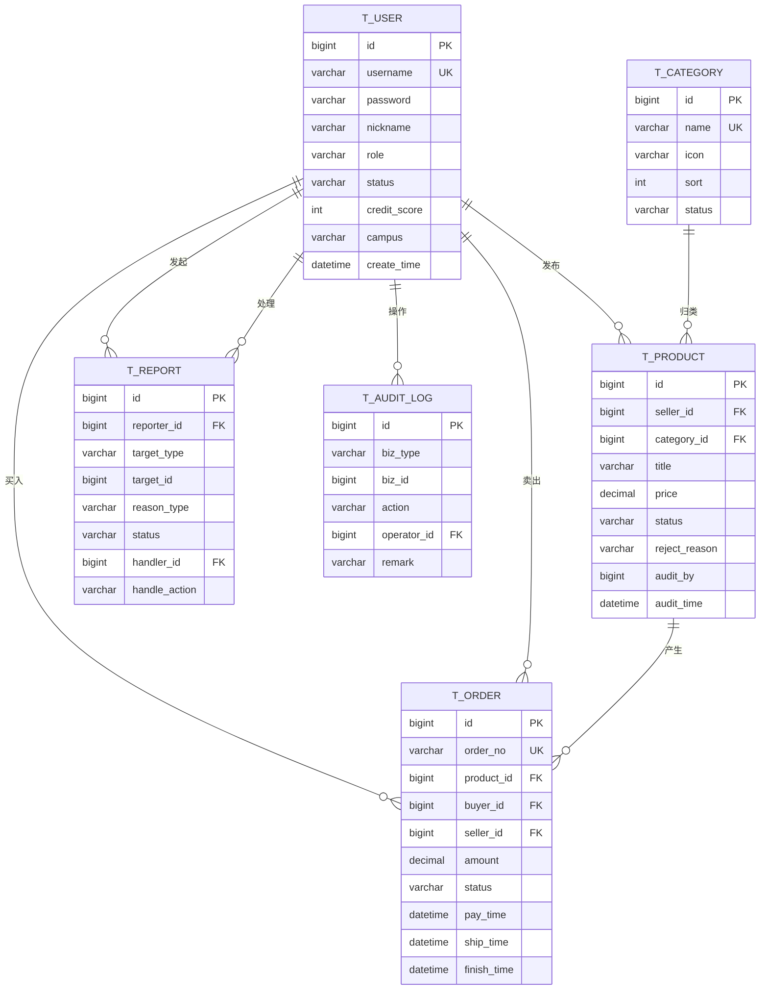
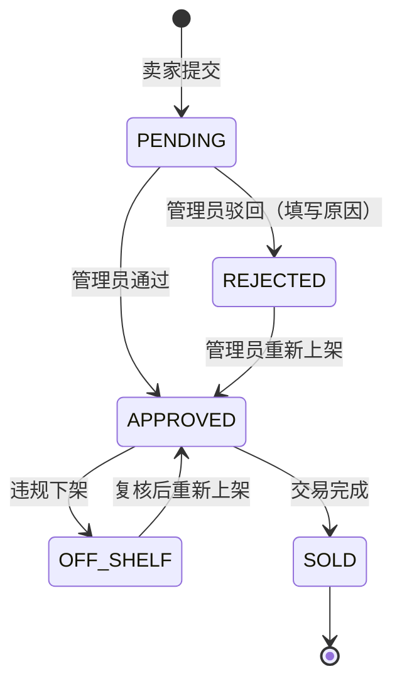
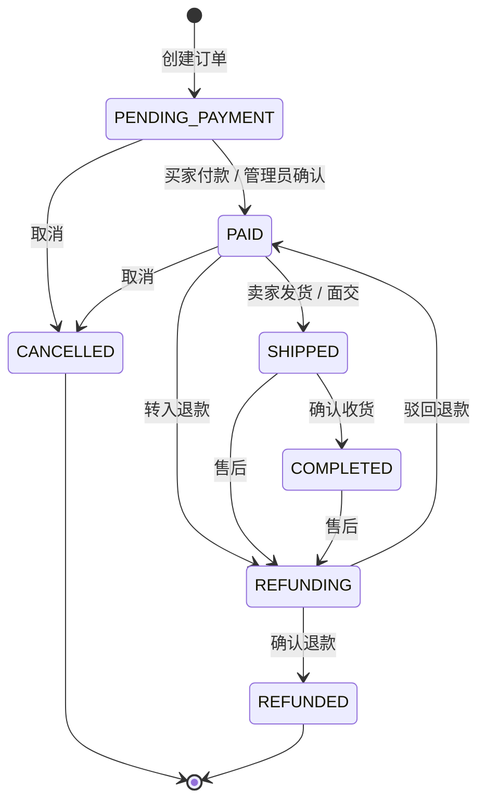
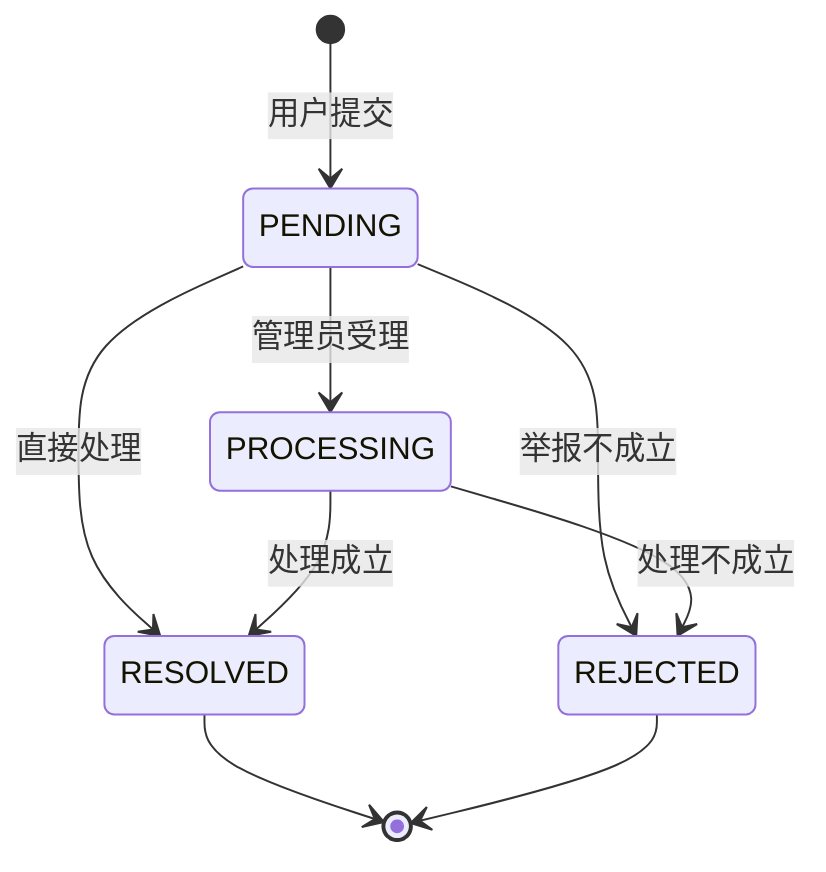

# 系统设计说明书

## 一、系统目标

校园二手交易平台后台管理系统面向平台管理员，解决三个核心问题：

1. **商品先审后发**：学生发布的二手商品必须经过管理员审核，防止违规、虚假、危险商品进入校园交易。
2. **交易全程可追溯**：订单从待付款、待发货、待收货到完成/退款，管理员可以查看并干预，所有操作留痕。
3. **举报闭环处理**：举报不是“标记已读”，而是可以联动下架商品、封禁用户、扣减信用分，并写入审核日志。

## 二、总体架构



### 分层职责

| 层次 | 职责 | 典型类 |
| --- | --- | --- |
| Filter | 编码、登录校验、侧边栏待办数量 | `EncodingFilter`、`AuthFilter`、`LayoutFilter` |
| Servlet | 接收参数、调用 Service、设置 request 属性、转发/重定向 | `ProductServlet`、`ReportServlet` |
| Service | 业务规则、状态校验、事务、组合 DAO | `ProductService`、`ReportService` |
| DAO | SQL、ResultSet 到 Bean 的映射 | `ProductDao`、`OrderDao` |
| Entity / DTO | 数据载体 | `Product`、`Report`、`DashboardData` |
| JSP | 服务端渲染，JSTL 输出与分支 | `product/list.jsp`、`report/detail.jsp` |

> 没有使用 Spring/Spring Boot，是为了贴合 Java EE 课程内容：Servlet 生命周期、Filter 链、Session、JDBC、事务、JSP 都在代码中直接可见。

## 三、目录结构

```text
src/main/java/com/campus/trade/
├── common/
│   ├── BizException.java            业务异常
│   ├── DbUtil.java                  Druid 连接池 + 事务模板
│   ├── DatabaseInitializer.java     首次启动建表 + 演示数据
│   ├── DateTimeUtil.java            LocalDateTime 格式化
│   ├── ExcelUtil.java               POI 导出
│   ├── PageResult.java              通用分页
│   ├── PasswordUtil.java            PBKDF2 密码
│   └── WebUtil.java                 URL 构造
├── entity/                          User / Category / Product / Order / Report / AuditLog
├── dto/                             DashboardData / TrendPoint / TargetInfo / UserDetail ...
├── dao/                             UserDao / ProductDao / OrderDao / ReportDao / ...
├── service/                         Auth / Product / Order / Report / User / Category / Dashboard
├── servlet/                         Login / Logout / Dashboard / Product / Order / ...
├── filter/                          Encoding / Auth / Layout
├── listener/                        AppContextListener
└── web/                             BaseServlet
```

## 四、数据库设计

### 4.1 ER 图



### 4.2 表清单

| 表 | 说明 | 关键字段 |
| --- | --- | --- |
| `t_user` | 用户/管理员 | `username` 唯一、`password` PBKDF2、`role`、`status`、`credit_score` |
| `t_category` | 商品分类 | `name` 唯一、`sort`、`status` |
| `t_product` | 二手商品 | `seller_id`、`category_id`、`price`、`status`、`reject_reason`、`audit_by` |
| `t_order` | 订单 | `order_no` 唯一、`product_id`、`buyer_id`、`seller_id`、`status`、各节点时间 |
| `t_report` | 举报 | `target_type` + `target_id` 多态关联、`reason_type`、`handle_action` |
| `t_audit_log` | 审核日志 | `biz_type` + `biz_id`、`action`、`operator_id`、`before_status`/`after_status` |

### 4.3 索引与约束

- 用户 `username`、分类 `name`、订单 `order_no` 唯一索引。
- 商品 `(status, create_time)`、订单 `(status, create_time)`、举报 `(status, create_time)` 组合索引，服务列表按状态 + 时间排序。
- 商品、订单、举报、日志均建立外键，保证引用完整性；用户不做物理删除，只做封禁。
- 金额统一 `DECIMAL(10,2)`，避免浮点误差。

## 五、状态机设计

### 5.1 商品状态



- 只有 `PENDING` 可以审核，防止重复审核。
- 驳回必须填写原因。
- 已售出商品不能下架/重新上架/删除。
- 有订单的商品不能物理删除，避免破坏交易数据。

### 5.2 订单状态



- 状态流转由 `OrderService.nextStatuses()` 统一给出可选目标，Service 再校验一次，防止前端伪造参数。
- `PAID` 写入 `pay_time`，`SHIPPED` 写入 `ship_time`，`COMPLETED` 写入 `finish_time`，`CANCELLED/REFUNDED` 写入 `cancel_time`。
- 每次流转写 `t_audit_log`，记录操作人、前后状态、备注。

### 5.3 举报状态



处理成立时可选附加动作：

| 动作 | 效果 |
| --- | --- |
| `NONE` | 只更新举报状态，不处罚 |
| `OFF_SHELF` | 下架被举报商品；若举报对象是订单，则下架订单对应商品 |
| `BAN_USER` | 封禁被举报用户；商品举报封禁卖家，订单举报封禁卖家 |
| `WARN` | 扣减被处罚用户 5 分信用，最低 0 分 |

### 5.4 用户状态

```text
ACTIVE（正常） <--> BANNED（封禁）
```

- 管理员不能封禁自己，也不能封禁其他管理员。
- 封禁必须填写原因。
- 重置密码会把密码改为 `123456`，并写日志。

## 六、URL 路由设计

| URL | 方法 | 说明 |
| --- | --- | --- |
| `/login` | GET/POST | 管理员登录 |
| `/logout` | GET | 退出登录 |
| `/admin/dashboard` | GET | 数据看板 |
| `/admin/products` | GET | 商品列表 / `action=detail` 详情 |
| `/admin/products` | POST | `action=audit/batch/status/delete` |
| `/admin/orders` | GET | 订单列表 / 详情 / `action=export` |
| `/admin/orders` | POST | 订单状态流转 |
| `/admin/reports` | GET | 举报列表 / 详情 / `action=export` |
| `/admin/reports` | POST | `action=handle/process` |
| `/admin/users` | GET | 用户列表 / 详情 |
| `/admin/users` | POST | `action=status/resetPassword` |
| `/admin/categories` | GET | 分类列表 / `action=edit` |
| `/admin/categories` | POST | `action=save/toggle/delete` |
| `/admin/audit-logs` | GET | 审核日志 |

所有 `/admin/*` 请求先经过 `AuthFilter`，未登录跳转 `/login?redirect=...`，非管理员返回 403。

## 七、关键业务流程

### 7.1 商品审核

```text
管理员打开待审核列表
→ 查看商品详情、卖家信息、描述
→ 通过：status=PENDING→APPROVED，记录 audit_by/audit_time
→ 驳回：status=PENDING→REJECTED，必须填写 reject_reason
→ 同一事务写入 t_audit_log
```

### 7.2 举报联动处理

```text
管理员查看举报详情与对象快照
→ 选择结论（成立/不成立）
→ 选择附加处罚（下架/封禁/警告）
→ 一个事务内：
   1. 更新 t_report（状态、处理人、处理说明、动作、时间）
   2. 若下架：更新 t_product.status=OFF_SHELF
   3. 若封禁：更新 t_user.status=BANNED
   4. 若警告：t_user.credit_score = max(0, credit_score-5)
   5. 写举报处理日志
   6. 写被处罚对象的联动日志
```

这一步是本项目的“特殊要求”重点：举报处理不是孤立状态，而是和商品、用户、信用分、日志联动。

### 7.3 订单状态流转

```text
管理员在订单详情页看到“当前状态允许的下一步”
→ 选择目标状态 + 备注
→ Service 再次校验状态机
→ 更新 t_order.status 与对应时间戳
→ 写 t_audit_log
```

## 八、安全设计

| 风险 | 措施 |
| --- | --- |
| SQL 注入 | 所有 SQL 使用 `PreparedStatement` 占位符，不拼接用户输入 |
| 密码泄露 | PBKDF2-HMAC-SHA256，12 万次迭代，随机 16 字节盐，格式 `pbkdf2$迭代$盐$摘要` |
| 未授权访问 | `AuthFilter` 拦截 `/admin/*`；JSP 放在 `WEB-INF/views` 下，浏览器无法直接访问 |
| 会话固定 | 登录成功后销毁旧 Session，再创建新 Session |
| XSS | 用户数据使用 `<c:out>` 输出；分类名称禁止尖括号 |
| CSRF | 课程项目未接入 Token；生产环境应增加 CSRF Token 与 SameSite Cookie |
| 越权 | 后台只允许 `role=ADMIN` 且 `status=ACTIVE` 的账号登录 |
| 重复提交 | 前端提交按钮锁定；服务端状态机校验防止重复审核/处理 |
| 数据一致性 | 审核、举报处理、订单流转、用户处罚使用 `DbUtil.inTransaction` |
| 审计追溯 | 商品、订单、举报、用户、分类的关键操作统一写 `t_audit_log` |

## 九、UI 设计

- 深色侧边栏 + 浅色内容区，品牌色为校园青绿色（`#0f766e`）。
- 看板使用统计卡、7 天柱状图、分类进度条、待办卡片、时间线。
- 列表页统一“筛选卡 + 表格 + 分页”结构。
- 详情页统一“左侧信息 + 右侧操作”的双栏结构，操作区粘性定位。
- 纯 CSS/JS，无 CDN；商品图使用本地 SVG，断网也能完整展示。
- 响应式：1440 桌面、1024 笔记本、768 平板、手机窄屏均有布局适配。

## 十、可扩展方向

1. 前台用户端：注册登录、发布商品、下单、支付、举报入口。
2. 图片上传：Servlet `Part` + 本地文件存储 / 对象存储。
3. 通知中心：审核结果、举报处理结果通知卖家/买家。
4. 权限细化：超级管理员、审核员、客服角色。
5. 支付与退款：对接校园支付或模拟支付。
6. 数据导出：商品、用户也增加 Excel 导出。
7. 缓存与性能：Redis 缓存看板统计，列表增加慢查询优化。
8. 安全加固：CSRF Token、登录失败次数限制、验证码、操作二次确认。
